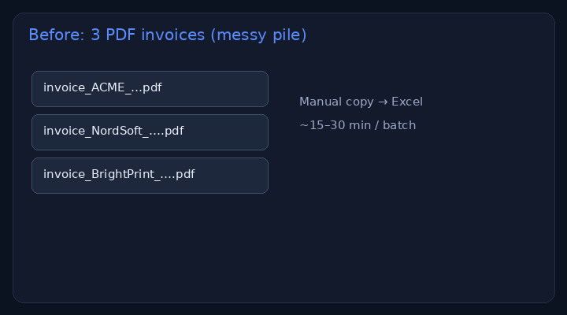

# PDF invoices → Excel rows

> **For non-technical clients — start here**
>
> **What it does:** Turns a folder of invoice PDFs into one clean Excel spreadsheet (vendor, date, total, currency…).
>
> **Try it (3 steps):**
> 1. Download this repo (or clone it).
> 2. Open a terminal in the folder and run: `pip install -r requirements.txt` then `python extract_invoices.py`
> 3. Open `output/invoices.xlsx` — your rows are ready.
>
> **Business benefit:** stop retyping invoices into Sheets. The 3-invoice sample batch runs in **under a minute**.



**Samples:** [`samples/`](./samples/) (3 fictional invoices) · **Output:** [`output/invoices.xlsx`](./output/invoices.xlsx)  
**Brand:** [Nyyo Automation](https://github.com/nyyoautomation)

[](#)
[](#)
[](#)

---

## What you get

- 3 sample invoices (PDF)
- Script that extracts: file, vendor, invoice #, dates, currency, subtotal, VAT, total
- Excel + CSV output with a Summary sheet by currency

## Run

```bash
pip install -r requirements.txt
python extract_invoices.py
# optional: python extract_invoices.py --samples ./samples --xlsx ./output/invoices.xlsx
```

## What’s for sale

| | |
|---|---|
| **Product** | Batch invoice / PDF → Excel tailored to your layout |
| **Includes** | Script + sample run + 1 revision |

Scanned (image) PDFs can use OCR in a client build — this public demo uses digital PDFs (no paid API).

→ Available on LaborX · [Profile & packages](https://github.com/nyyoautomation)

## How to order

Available on LaborX · [Profile & packages](https://github.com/nyyoautomation)

Questions? Ask in your order chat.

## Limits (honest)

- Sample PDFs are **fictional**. Layouts in the wild vary — production extractors are tuned per vendor template.
- Image-only scans need OCR (available on request).
